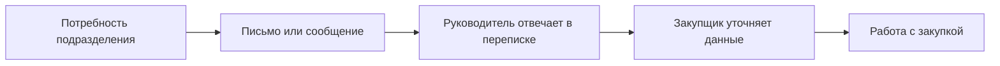
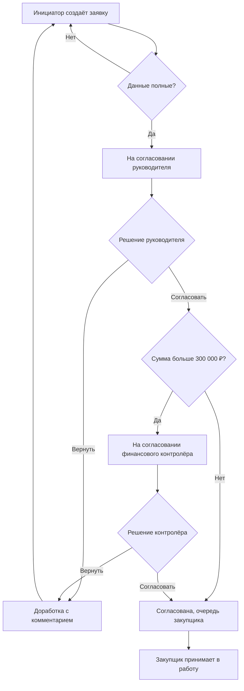

# Схема процесса

## Как есть

Статус, ответственный и история решений распределены по разным каналам.

## Как будет

**Событие передачи:** статус «Согласована». С момента принятия закупщиком статус меняется на «В работе закупок». Названия статусов проектные.
